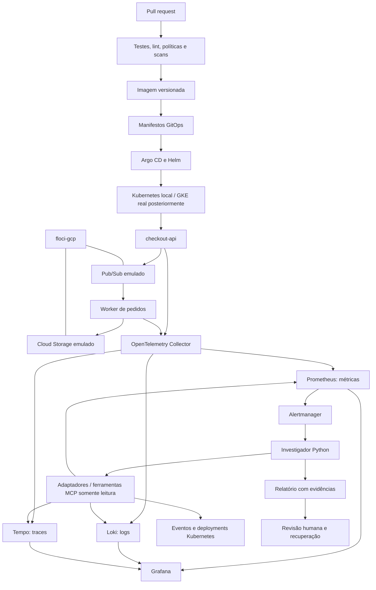

# CloudOps AI Lab — plano detalhado de execução

Data: 6 de novembro de 2026. Estado: planejamento; tarefas abaixo não representam implementação concluída.

## 1. Objetivo e prioridades

Construir um portfólio público para DevOps Sênior, SRE, Engenharia de Plataforma e AI Engineer. O projeto principal é o AI SRE Incident Investigator, sustentado por quatro projetos complementares. Kubernetes/GKE, observabilidade e ferramentas de IA são os pilares de todas as entregas.

Ordem dos provedores: **GCP → AWS → Azure**. Documentação principal em português; README em inglês como entrega adicional para divulgação internacional. Não criar uma organização GitHub apenas por formalidade: os projetos podem começar na conta atual.

Primeiro resultado demonstrável: uma aplicação real no Kubernetes sofre uma falha controlada, gera telemetria, dispara um alerta e é investigada por um agente que apresenta evidências, hipóteses e recomendações revisadas por uma pessoa.

## 2. Escopo e limites

- MVP integrado em cinco semanas, estimado em 12–16 horas semanais; é uma estimativa de trabalho, não um prazo garantido.
- Consolidação dos cinco projetos em dez semanas, com mais 60–80 horas estimadas.
- O MVP cobre o investigador e as bases de infraestrutura, plataforma e confiabilidade. O revisor de Terraform completo vem na segunda etapa.
- Laboratório local primeiro; GKE real em etapa controlada. Não afirmar experiência validada em GKE com base apenas em kind ou emulação.
- Backstage, RAG, remediação automática e operação simultânea em três nuvens ficam fora do MVP.
- Nenhum recurso pago será criado por este plano. Provisionamento real será uma execução separada, após definir orçamento e configuração concreta.

## 3. Arquitetura integrada

As setas de telemetria representam o fluxo lógico. Protocolos, receivers e exporters serão fixados e testados na implementação. O caminho de métricas usará exposição compatível com scrape do Prometheus; logs terão integração OTLP compatível com Loki; traces serão enviados ao Tempo.

### Três ambientes com evidências separadas

| Ambiente | Finalidade | O que não comprova |
| --- | --- | --- |
| Compose + floci-gcp | Validar operações de integração cloud suportadas | IAM, rede, disponibilidade e desempenho do GCP real |
| kind | Executar workloads, GitOps, telemetria e incidentes Kubernetes reais | Comportamento do serviço gerenciado GKE |
| GKE real | Validar identidade, rede, armazenamento, operação e escalabilidade no GCP | Paridade automática com AWS ou Azure |

O floci-gcp não substitui o cluster kind. No primeiro MVP, não usaremos o GKE emulado como evidência de GKE gerenciado. A aplicação precisará alcançar o emulador a partir dos pods; documentar e testar a configuração de rede para Windows/Docker Desktop e Linux/CI, sem fixar IP de máquina pessoal.

## 4. Repositórios e contratos

| Repositório | Responsabilidade | Artefato consumido pelos demais |
| --- | --- | --- |
| cloudops-ai-lab | Catálogo, arquitetura, roteiro e manifesto de versões | Índice de releases compatíveis e guia da demonstração |
| ai-sre-incident-investigator | Adaptadores, correlação, LLM, MCP e avaliação | Imagem do investigador, schemas e relatórios |
| floci-multicloud-lab | Compose, integração cloud e Terraform; GCP inicialmente | Endpoints locais, recursos e testes de contrato |
| platform-gitops-lab | Aplicação de exemplo, chart Helm, kind, Argo CD e overlays GKE | Imagem da aplicação e configuração de deployment |
| ai-terraform-reviewer | Políticas, leitura de plano e parecer de IA | Relatório JSON/Markdown e workflow reutilizável |
| sre-reliability-lab | Dashboards, alertas, SLOs, k6, falhas e postmortems | Pacote de observabilidade e cenários de incidente |

São cinco projetos técnicos mais um repositório central. Criar os complementares conforme sua primeira entrega concreta. Não duplicar código da aplicação em cada projeto: imagens e charts devem ser referenciados por versão. O hub manterá um manifesto com commit, imagem/digest e chart utilizados na demo integrada.

Estrutura mínima por projeto: README.md em português, README.en.md, LICENSE, docs/architecture.md, docs/decisions/, docs/runbook.md, docs/demo.md, examples/, tests/, scripts/, .env.example e .github/workflows/ci.yml. Criar diretórios quando houver conteúdo. Oferecer comandos equivalentes para PowerShell e Linux; Makefile poderá ser um atalho adicional.

## 5. Aplicação compartilhada

Proposta de implementação: API e worker em Python para reduzir a quantidade de linguagens no MVP. Registrar a escolha em ADR antes de codificar.

1. POST /orders valida um pedido sintético e publica um evento no Pub/Sub.
2. Um worker consome o evento, persiste o resultado em Cloud Storage e confirma a mensagem somente após a persistência.
3. O identificador do pedido permite tratar mensagens duplicadas; testar reentrega sem duplicar efeitos.
4. GET /healthz indica vida do processo e GET /readyz indica prontidão; detalhar dependências que devem afetar prontidão.
5. Propagar contexto de trace nos atributos da mensagem para correlacionar API e worker.
6. Logs JSON contêm timestamp UTC, serviço, versão, nível, trace_id e incident_id quando aplicável. Não registrar dados pessoais.
7. Falhas são ativadas apenas por configuração de laboratório, desabilitadas por padrão: atraso de dependência, erros e saturação controlada.

Testes: contrato HTTP, publicação/consumo, persistência, reentrega, indisponibilidade de dependência e propagação de contexto. Não introduzir banco de dados antes de existir necessidade demonstrada.

## 6. Projeto 1 — AI SRE Incident Investigator

**Prioridade máxima e demonstração principal.**

### Implementação

- Contrato de entrada: incident_id, serviço, ambiente, severidade, início/fim UTC e referência ao alerta.
- Adaptadores Prometheus, Loki, Tempo e Kubernetes com timeout, intervalo máximo, paginação, limite de resultados e tratamento explícito de fonte indisponível.
- Coleta Kubernetes restrita ao namespace do laboratório: pods, eventos, deployments e ReplicaSets. Não ler Secrets nem executar comandos nos pods.
- Normalização das evidências: id, origem, consulta, intervalo, horário da coleta, resumo, referência e estado da consulta.
- Correlação inicial determinística: comparar versões/deploys, p95, taxa de erro, reinícios e saturação antes/depois do início do incidente.
- Saída inicial sem LLM; depois adicionar provedor de modelo substituível e respostas simuladas para CI.
- Validar saída por schema: resumo, impacto observado, timeline, hipóteses ordenadas, evidências, lacunas e validações recomendadas.
- Verificar programaticamente se cada evidence_id existe no conjunto recuperado. Evidência ausente ou contraditória deve aparecer como limitação.
- MCP expõe ferramentas delimitadas, como query_metrics, search_logs, get_trace e list_deployment_events. Validar argumentos e limitar resultados; não oferecer shell genérico.
- Logs, traces e conteúdo retornado por ferramentas são dados não confiáveis; não podem alterar as instruções do agente.

### Avaliação e aceite

Criar pelo menos oito casos rotulados: três famílias de falhas, um caso saudável, evidência insuficiente, fonte indisponível, sinais contraditórios e tentativa de injeção em log. Medir acerto da hipótese principal, referências válidas, afirmações sem suporte, abstenção adequada, duração e consumo do modelo. Publicar resultados por caso e comparação com a base determinística.

Aceite: três incidentes reproduzíveis investigados; 100% das referências emitidas resolvem para evidências existentes; nenhuma alteração automática no cluster; fonte ausente não gera causa confirmada; relatório Markdown/JSON e vídeo de 2–4 minutos disponíveis. O percentual é uma meta de aceite, não um resultado já obtido.

## 7. Projeto 2 — Multi-Cloud Infrastructure Lab

### Fase GCP

- Fixar uma versão do floci-gcp e, após validar a imagem, seu digest. Não usar latest no artefato reproduzível.
- Compose com porta exposta somente em loopback, persistência opcional e limpeza documentada. Não montar o socket Docker para o recorte inicial de Storage/Pub/Sub.
- Montar matriz por operação: bucket create/list/delete, object upload/download/delete, topic/subscription create/delete, publish/pull/ack. Cada linha registra versão, teste, resultado e diferença conhecida.
- Usar projeto sintético e credenciais fictícias apenas quando exigidas pelo cliente. O caminho local não deve procurar credenciais reais automaticamente.
- Validar endpoints customizados do provider Terraform antes de desenhar módulos. Se uma operação não funcionar, registrar a lacuna e não declarar Terraform validado com base apenas em SDK.
- Terraform: fmt, init, validate, apply local, teste de integração, segundo plan sem alterações e destroy. Separar estado e variáveis locais do ambiente GCP real.
- Impedir execução acidental contra nuvem real no modo local por validação de endpoints e configuração explícita; testar essa proteção.
- CI sobe emulador, aguarda prontidão com timeout, executa testes e remove recursos mesmo após falha.

Aceite: fluxo API → Pub/Sub → worker → Storage funciona do zero; segunda execução é previsível; teste de limpeza passa; CI local não usa segredo GCP; documentação distingue API emulada de comportamento gerenciado.

### Expansão posterior

AWS: implementar cenário equivalente com SQS/S3 e Floci AWS. Azure: escolher fila e armazenamento após validar suporte do floci-az. Cada provedor recebe contratos e matriz próprios; não abstrair diferenças de semântica que ainda não foram medidas.

## 8. Projeto 3 — GitOps Platform Engineering

- Bootstrap kind em comando documentado; perfis mínimo e completo com requisitos medidos de CPU/RAM.
- Namespaces distintos para aplicação, observabilidade e ferramentas de plataforma.
- Chart da aplicação com Deployment, Service, ConfigMap, probes, requests/limits, securityContext, ServiceAccount e configuração de endpoints.
- Usuário não root, capacidades mínimas, filesystem somente leitura onde viável e Secrets fora do Git.
- Argo CD com dev e staging locais. Git é a fonte de estado; CI gera imagem e mudança de versão por PR.
- Políticas verificam imagem versionada, ausência de privilégios excessivos, recursos e configurações obrigatórias. Demonstrar uma rejeição real.
- HPA e PodDisruptionBudget com cenários de verificação; explicar os limites de um cluster local com poucos nós.
- Demonstrar drift controlado, reconciliação, rollout defeituoso e rollback por Git revert.
- Golden path inicial por template e script; Backstage apenas após o fluxo por PR estar funcionando.

### Evolução GKE

ADR compara Standard e Autopilot conforme objetivos de aprendizagem, permissões e estimativa vigente. Terraform define projeto/serviços necessários, rede, cluster e identidade; evitar chaves estáticas de service account. Validar Workload Identity Federation for GKE, acesso ao registro, conectividade, políticas e armazenamento. Medir comportamento de rollout e escalabilidade em GKE separadamente.

Aceite: novo serviço criado pelo template, PR validado, sincronização Argo CD observável, política insegura rejeitada e rollback demonstrado. Evidência de GKE somente após execução real com limpeza confirmada.

## 9. Projeto 4 — AI Terraform Reviewer

- PR executa fmt, validate, scanner de IaC e políticas determinísticas.
- Fixtures de plano JSON para CI sem nuvem; plano real apenas em ambiente confiável e separado.
- Normalizar criação, atualização, substituição e exclusão; evidenciar endereço do recurso e campo relevante.
- Regras iniciais: exposição pública indevida, permissão excessiva, exclusão de recurso crítico e ausência de convenções obrigatórias.
- LLM resume as evidências e dúvidas; violações críticas são bloqueadas pelas regras mesmo que o modelo discorde.
- Redigir dados sensíveis antes de persistir ou enviar ao modelo; plano e estado podem conter dados sensíveis.
- Custo: no MVP, sinalizar fatores de custo e marcar valor monetário como não calculado. Estimativa numérica exige fonte de preço, região, premissas e data.
- PR de fork roda verificações sem segredos. Não executar código não confiável com token privilegiado; separar publicação do parecer da execução do PR e validar artefatos recebidos.
- Começar com parecer como artefato; comentário de PR em etapa posterior com permissão mínima e atualização idempotente.

Aceite: fixtures seguras, inseguras, destrutivas, sensíveis e maliciosas são tratadas corretamente; parecer cita o plano/política; nenhuma aprovação nem apply automático.

## 10. Projeto 5 — SRE Reliability Engineering Lab

- Jornada síncrona: pedidos válidos aceitos pela API. Jornada assíncrona separada: pedidos aceitos e persistidos dentro do prazo definido após medir a base.
- SLI de disponibilidade: respostas bem-sucedidas / requisições elegíveis; documentar exclusão de health checks e tratamento de 4xx, 5xx e timeouts.
- SLI de latência: requisições elegíveis concluídas abaixo de um limiar / requisições elegíveis. Escolher limiar após medir comportamento saudável.
- SLO inicial de disponibilidade proposto: 99,9% em 30 dias; erro permitido de 0,1% das requisições elegíveis. Não converter automaticamente esse orçamento em minutos para um SLO baseado em requisições.
- No laboratório curto, usar janela de demonstração explicitamente identificada; não alegar 30 dias medidos sem histórico.
- Regras de burn rate com duas janelas e critérios de tráfego mínimo; testar alertas disparando e resolvendo com fixtures e execução real.
- Dashboards: RED da API, latência/erros do worker, backlog, recursos/reinícios dos pods, SLO e saúde da coleta.
- Não usar order_id ou trace_id como label de métrica; limitar cardinalidade e retenção.
- k6 mede base saudável e cenário degradado com mesma configuração versionada. Registrar recursos disponíveis e taxa de tráfego.

| Incidente | Injeção controlada | Evidências esperadas | Recuperação |
| --- | --- | --- | --- |
| Dependência lenta | Atraso no adaptador da aplicação | p95 maior, spans lentos, logs correlacionados | Remover atraso |
| Deployment regressivo | Versão de laboratório com falha | Erros após rollout, versão e eventos | Git revert |
| Saturação do worker | Carga limitada e CPU restrita | Backlog, CPU/throttling e processamento lento | Reduzir carga/restaurar recursos |

Cada experimento tem limite de duração, namespace/contexto permitido, comando de parada e retorno ao estado saudável. Publicar runbook e postmortem sem atribuição de culpa.

Aceite: três falhas, alertas e recuperação reproduzíveis; métricas e regras testadas; ao menos um alerta chega ao investigador com a janela correta.

## 11. Cronograma e dependências

| Semana | Trabalho principal | Evidência de conclusão |
| --- | --- | --- |
| 1 | ADRs, Compose, floci-gcp e primeiro recorte Terraform | Matriz inicial, bootstrap e apply/test/destroy local ou lacuna explicitamente bloqueada |
| 2 | API/worker, testes, imagem e GitHub Actions | Evento publicado, consumido e persistido; CI verde |
| 3 | kind, Helm, Argo CD e observabilidade básica | Deployment GitOps e uma requisição correlacionada em métricas/logs/traces |
| 4 | Primeiro SLO, incidente e investigador determinístico + LLM mínimo | Relatório de um incidente com evidências verificadas |
| 5 | Integração, correções, guia de reprodução e vídeo | Outra pessoa executa a demo; primeira publicação técnica preparada |
| 6 | Políticas Kubernetes, template e recuperação | Drift/rollback e manifesto inseguro rejeitado |
| 7 | Três incidentes, alertas completos e postmortems | Suite de confiabilidade e integração Alertmanager |
| 8 | MCP, avaliação do agente e tratamento de falhas | Casos rotulados e comparação com base determinística |
| 9 | Revisor Terraform e preparação GKE | Fixtures/políticas e plano concreto de custo, identidade e limpeza |
| 10 | Validação GKE quando viável, catálogo e documentação bilíngue | Demo GKE se executada; caso contrário pendência explícita, sem alegar conclusão |

Dependência crítica: integração cloud → aplicação → Kubernetes/telemetria → incidente → investigador. O projeto principal tem prioridade de produto, mas precisa dessas fundações para produzir uma demonstração real. Se faltar capacidade, reduzir o MVP para uma falha e um relatório antes de acrescentar Backstage ou outra nuvem. AWS e Azure entram depois da consolidação GCP, sem prazo artificial nesta fase.

## 12. Primeiras 72 horas de execução

### Dia 1 — fundação verificável

- Registrar ADRs: GCP primeiro; kind versus emulação versus GKE; linguagem; contratos de telemetria e IA somente leitura.
- Criar backlog com uma issue por entrega verificável e dependências entre issues.
- Preparar Compose e smoke test; confirmar versão e operações Storage/Pub/Sub usadas.
- Definir padrão de comandos bootstrap, test, demo e down para Windows e Linux.

### Dia 2 — fluxo funcional mínimo

- Implementar API/worker com identificador de pedido e teste de reentrega.
- Validar publicação, consumo, persistência e limpeza com teste ponta a ponta.
- Adicionar logs estruturados e primeiro trace API → worker.

### Dia 3 — repetibilidade

- Validar Terraform para o subconjunto suportado e documentar eventuais bloqueios.
- Executar CI em runner limpo, sem credenciais cloud.
- Registrar versões, comandos, resultado e demonstração curta. Depois iniciar o chart Kubernetes.

## 13. Qualidade, segurança e custos

Cada PR deve executar verificações relevantes: testes unitários de lógica e contratos, integração quando afetada, lint, validação de configuração e scan aplicável. Fixar actions por SHA, dependências por lock e imagens por versão/digest. Usar permissões mínimas no GITHUB_TOKEN, timeout, cleanup e atualização automatizada de dependências. Não declarar segurança concluída apenas por instalar um scanner.

Local: custo de CPU, memória, disco e energia; medir os perfis antes de publicar requisitos. CI: conferir limites vigentes da conta. LLM: mocks no CI; demos reais com limite de chamadas, tokens e gasto configurados. GKE: estimativa com região, modo, capacidade, duração, discos, registro, rede e retenção de telemetria antes de criar recursos. Não há preço mensal estimado neste documento porque a configuração ainda não foi escolhida.

Alertas de orçamento não devem ser tratados como garantia de desligamento. Validar controles de gasto disponíveis no serviço e testar limpeza separadamente. Ao terminar uma sessão cloud, verificar cluster, discos, endereços, balanceadores e outros recursos residuais; registrar resultado.

## 14. Evidências e divulgação

Cada release demonstrável contém: README reproduzível, arquitetura, ADRs, testes, CI identificada, limitações, procedimento de limpeza, screenshots sem segredos e vídeo de 2–4 minutos. Resultados medidos incluem método, ambiente, janela e versão.

Publicações sugeridas: integração GCP local; GitOps no Kubernetes; telemetria correlacionada e SLO; investigação com IA e suas limitações; validação GKE e retrospectiva. Preparar textos e mídias; publicação no LinkedIn será uma ação separada solicitada pelo usuário.

Nas entrevistas: explicar decisões, diferenças entre local e gerenciado, incidentes, políticas rejeitadas, falhas do agente e melhorias medidas. Não publicar redução de MTTR sem um experimento comparativo que sustente a conclusão.

## 15. Definition of Done e estado atual

Uma tarefa termina quando o comportamento funciona, as verificações passam, os comandos foram reproduzidos, a documentação corresponde ao resultado e a evidência está vinculada. Tarefas bloqueadas registram causa, alternativa e impacto.

Concluído até esta revisão: repositório central público, licença MIT, README em português e prioridades registradas. Este documento detalha o trabalho futuro. Não há laboratório, cluster, aplicação, pipeline ou agente implementado por esta entrega de planejamento.

Próxima entrega concreta: Compose do floci-gcp e teste de contrato Storage/Pub/Sub, seguidos do fluxo mínimo da aplicação. Não iniciar provisionamento GKE enquanto a configuração e os controles de custo não estiverem definidos.

## 16. Referências técnicas

- [floci-gcp: serviços, integração e limitações](https://github.com/floci-io/floci-gcp)
- [Visão geral do GKE](https://cloud.google.com/kubernetes-engine/docs/concepts/kubernetes-engine-overview)
- [Sinais do OpenTelemetry](https://opentelemetry.io/docs/concepts/signals/)
- [Orçamentos e alertas no Google Cloud](https://cloud.google.com/billing/docs/how-to/budgets)

Referências consultadas em 6 de novembro de 2026. Revalidar suporte, versões e preços na implementação.

## 17. Aplicações e casos de operação

As aplicações serão pequenas, funcionais e conectadas aos cinco projetos. Os casos reproduzem classes de problemas de produção em laboratório; não representam incidentes de empresas nem resultados reais de produção. Cada aplicação terá execução saudável antes de receber mecanismos de falha.

### Aplicação A — checkout e pedidos

**Problema de negócio:** receber pedidos sem duplicação e acompanhar seu processamento. Componentes: checkout-api, Pub/Sub e order-worker com persistência no Storage no primeiro recorte. A aplicação compartilhada da seção 5 é o primeiro incremento desta aplicação.

**Casos separados:**

| Caso | Sintoma e impacto | Evidências a coletar | Resolução a implementar e verificar |
| --- | --- | --- | --- |
| A01 — dependência lenta | Aumento do p95, timeouts e pedidos sem confirmação | Trace da dependência, duração HTTP, timeout e taxa de sucesso | Timeout explícito, retry limitado com jitter apenas em operações seguras e orçamento total de tempo; repetir carga e verificar recuperação |
| A02 — reentrega de mensagem | Mesmo pedido processado mais de uma vez | message_id, order_id nos logs, contagem de tentativas e registros persistidos | Idempotência e confirmação após persistência; forçar falha entre persistir e confirmar e verificar efeito único |
| A03 — deployment regressivo | Erros aumentam após nova versão | Deployment/ReplicaSet, versão nos sinais e comparação antes/depois | Git revert, reconciliação e smoke test; corrigir contrato e acrescentar teste de regressão |

**Aceite funcional:** pedido válido percorre API → fila → worker → armazenamento; entrada inválida é rejeitada; reentrega não duplica o resultado. A forma de persistência e controle concorrente da idempotência deve ser definida e testada antes de afirmar garantia de efeito único.

### Aplicação B — processamento de arquivos

**Problema de negócio:** receber arquivos sintéticos, processá-los de forma assíncrona e consultar o estado. Componentes: upload-api, Storage, Pub/Sub e processing-worker. Reutilizar bibliotecas e charts da aplicação A, preservando domínio e cenários próprios.

| Caso | Sintoma e impacto | Evidências a coletar | Resolução a implementar e verificar |
| --- | --- | --- | --- |
| B01 — backlog crescente | Arquivos aguardam além do prazo | Idade da mensagem mais antiga, profundidade da fila, duração e throughput do worker | Limitar concorrência por worker, ajustar capacidade e testar escalabilidade; comprovar drenagem sem sobrecarregar dependências |
| B02 — memória esgotada | Worker reinicia e arquivos não terminam | OOMKilled, working set, tamanho do arquivo e tentativas | Processamento em streaming, limite de entrada e dimensionamento; repetir arquivo causador com memória limitada |
| B03 — mensagem inválida | Repetição contínua de falha bloqueia progresso | Erro de validação, tentativas e pedidos saudáveis atrasados | Tentativas limitadas e quarentena; demonstrar que mensagens saudáveis continuam e que há reprocessamento controlado |

**Aceite funcional:** arquivo pequeno é processado e seu estado fica consultável; entrada excessiva é rejeitada; arquivo inválido não impede processamento de outros. Validar suporte a dead-letter no emulador antes de depender dele; se necessário implementar quarentena explícita na aplicação e documentar a diferença.

### Aplicação C — entrega de webhooks

**Problema de negócio:** entregar notificações para parceiros com falhas transitórias. Componentes: webhook-api, fila, delivery-worker e partner-mock configurável. Não chamar endpoints de terceiros reais.

| Caso | Sintoma e impacto | Evidências a coletar | Resolução a implementar e verificar |
| --- | --- | --- | --- |
| C01 — parceiro responde 429 | Retentativas aumentam carga e atrasam notificações | Status HTTP, Retry-After, taxa de tentativas e idade da fila | Respeitar Retry-After, backoff com jitter e limite de concorrência; verificar redução de chamadas e recuperação |
| C02 — parceiro indisponível | Fila cresce e threads ficam ocupadas | Timeouts, conexões, traces e entregas pendentes | Timeout, circuit breaker e isolamento de capacidade; testar abertura, recuperação e ausência de tempestade de retries |
| C03 — credencial de teste rotacionada | Entregas recebem 401 após mudança | Versão de configuração, status HTTP e evento de rollout sem conteúdo do segredo | Atualizar referência/configuração e fazer rollout controlado; verificar retomada e ausência de segredo nos logs |

**Aceite funcional:** webhook chega ao partner-mock; falha transitória é recuperada; chave de idempotência permite deduplicação no receptor; falha permanente fica visível e não gera retry infinito.

### Organização do código e das evidências

No primeiro incremento, as aplicações ficam em platform-gitops-lab/apps/checkout, apps/file-processing e apps/webhook-delivery, com charts correspondentes. Não criar três aplicações completas em paralelo: terminar checkout com o caso A03 e o investigador mínimo antes de começar processamento de arquivos; webhooks vem depois.

Os casos operacionais ficam em sre-reliability-lab/scenarios/A01, A02, A03, B01 etc. Cada diretório contém:

1. context.md: negócio, arquitetura, sintomas, impacto e SLI/SLO afetado.
2. preconditions.md: versões, carga, recursos, namespace e estado saudável necessário.
3. inject: comando/script idempotente de falha com limite de duração e contexto permitido.
4. evidence: consultas, dashboards, traces e logs sanitizados da execução, com timestamps e versão.
5. investigation.md: fatos observados, hipóteses, testes de validação e causa confirmada após comprovação.
6. resolution.md: mitigação imediata, correção permanente, trade-offs e rollback.
7. verify: teste que comprova recuperação, efeito funcional e ausência de recorrência no cenário definido.
8. postmortem.md: timeline, impacto observado, fatores contribuintes e ações preventivas.
9. cleanup: restauração e verificação de que o ambiente voltou ao estado saudável.

Criar os arquivos de evidência após executar o cenário. Exemplos preparados previamente devem ser identificados como fixtures, nunca apresentados como medições.

### Uso dos casos pela IA

Para cada execução, separar o conjunto de evidências fornecido ao investigador do gabarito usado na avaliação. O agente não recebe a causa injetada no prompt. Registrar relatório antes da resolução, comparar com o gabarito e avaliar hipótese, evidências, incerteza e recomendações. Incluir casos sem falha e casos de causa desconhecida. A correção é aplicada por fluxo humano/GitOps e verificada pelos mesmos testes funcionais e SLIs.

### Incrementos e impacto no cronograma

- MVP de cinco semanas: somente checkout, A03 como cenário completo obrigatório e A01 se houver capacidade. Não exigir as três aplicações para validar o primeiro incremento.
- Consolidação: fechar A01–A03, depois implementar B01 e B02. B03 e aplicação C entram em uma etapa adicional após esses aceites.
- Nove casos completos e três aplicações ampliam o escopo original; não estão prometidos no mesmo prazo de cinco ou dez semanas. Reestimar após medir o esforço do primeiro caso.
- Evidência final por caso: executar comportamento saudável → injetar falha → observar alerta → investigar → mitigar → corrigir → repetir teste → documentar resultado.
